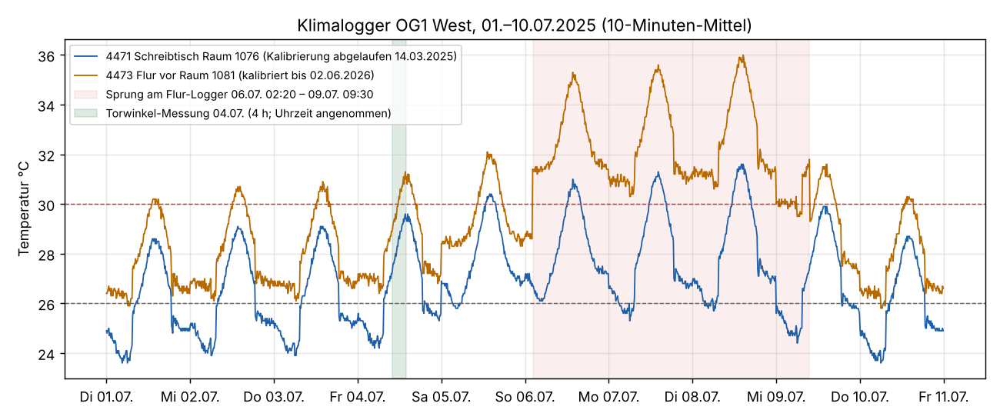
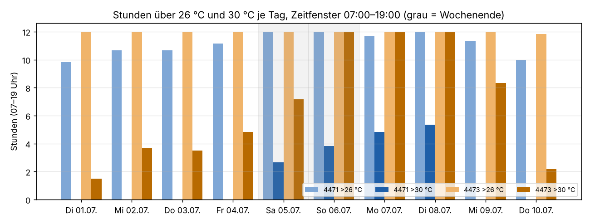

# A153 Raumklima und Messberichte prüfen – Ismail Herbst

**Entwurf von Claude (KI-Agent Ismail) · ruht bis auf Weiteres · Status: zu prüfen**

## 1. Die vier Berichte von Torwinkel

| Nr. | Messdatum | Ort | Dauer | Punkte | Außen | Werte (Mittel/Max) | Richtwert im Bericht | Nachmessung | Urteil |
|---|---|---|---|---|---|---|---|---|---|
| 04.27.016 | 07.11.2020 | OG2 West | 4 h | 1 | 9 °C | 19,9/20,3 °C; CO₂ 1.199/1.255 ppm | Soll 20 °C | „im Rahmen der nächsten Wartung“ – nicht belegt | Messung knapp, Ursache (Ventil) plausibel; CO₂ über 1.000 ppm nicht bewertet |
| 04.27.018 | 17.02.2021 | Technikzentrale | 4 h | 1 | 8 °C | 17,8/18,3 °C; CO₂ 1.129/1.317 ppm | Soll 20 °C | **Widerspruch:** „in zwei Wochen“ und „im Rahmen der nächsten Wartung“ – nicht belegt | Beschwerde war Zugluft – Luftgeschwindigkeit 0,18/0,32 m/s gemessen, aber nicht bewertet |
| 04.27.020 | 23.07.2022 | UG Lager | 4 h | 1 | 26 °C | 28,2/29,2 °C; CO₂ 1.288/1.497 ppm | 26 °C „Richtgröße des Betreibers“ | „nicht erforderlich“ | **Ursache „Sonnenschutz nicht aktiviert“ unplausibel – UG Lager hat keine Fenster** |
| 04.27.029 | 04.07.2025 | OG1 West | 4 h | 1 | 24 °C | 28,8/29,5 °C; CO₂ 1.097/1.314 ppm | 26 °C „Richtgröße des Betreibers“ | „im Rahmen der nächsten Wartung“ – nicht belegt | Bewertung „Kälteleistung reicht knapp“ ohne Messung an der Kälte; nur 1 Punkt, Uhrzeit fehlt |

Methode allgemein: jeweils ein Punkt, 4 Stunden, „Arbeitshöhe“ ohne Zentimeterangabe, Tageszeit nicht angegeben. Für eine Aussage über einen ganzen Raum oder eine Anlage reicht das nicht.
Richtwerte (Einschätzung, im Original nachlesen): ASR A3.5 – Lufttemperatur soll 26 °C nicht überschreiten, über 26 °C Maßnahmen empfohlen, über 30 °C Maßnahmen erforderlich, über 35 °C Raum ohne weitere Maßnahmen nicht als Arbeitsraum geeignet; Mindestwerte für Büro (sitzend, leicht) 20 °C. ASR A3.6 – CO₂ bis 1.000 ppm unbedenklich, 1.000–2.000 ppm Lüftungsverhalten prüfen und verbessern. **Alle vier Berichte haben CO₂ über 1.000 ppm und bewerten es nicht.**

## 2. Eigene Loggerdaten (Klimalogger_OG1_West_Juli_2025.xlsx)

Hinweis zum ersten Diagramm: Die grüne Fläche am 04.07. markiert 10–14 Uhr nur als **Annahme** – der Bericht nennt keine Uhrzeit.

## 3. Zahlentabelle (Werktage, 07:00–19:00)
Zeitfenster 07:00–19:00, Mo–Fr = Betriebszeiten laut Raumbuch (Firmenbriefing Abschn. 6). Werktage im Export: 01.–04.07. und 07.–10.07.2025 (8 Tage; 30.06. und 11.07. nicht exportiert).

| Logger | Ort | Stunden > 26 °C | Stunden > 30 °C |
|---|---|---|---|
| 4471 | Schreibtisch Raum 1076, 1,1 m | **87,3 h** | **10,2 h** |
| 4473 | Flur vor Raum 1081, 1,6 m | **95,8 h** | **48,0 h** (davon rund 32 h am 07.–09.07. im Sprung) |

Vergleich 04.07.2025: Torwinkel Mittel 28,8 / Max 29,5 °C; unser Schreibtisch höchster 4-Stunden-Mittelwert 29,2 °C (12:10–16:10), Tagesmax 29,6 °C – **praktisch gleich**.
Tag/Nacht (Mittel 07–19 / 22–06 Uhr): Schreibtisch 27–30 °C / 24–27 °C; Flur ständig ca. 1,6–1,8 K wärmer, kühlt nachts kaum unter 26 °C ab.

## 4. Auffälligkeit
Am Flur-Logger 4473 springt die Temperatur **am Sonntag, 06.07.2025, gegen 02:20 Uhr um rund 3 K** (28,6 → 31,4 °C), während der Schreibtisch-Logger sinkt. Der Abstand zwischen beiden steigt von 1,7 K auf rund 5 K und fällt **am 09.07. gegen 09:30 Uhr** schlagartig zurück. Das passt nicht zu Wetter oder Lüftung (sonst wäre auch der Schreibtisch betroffen), sondern zu einer **örtlichen Wärmequelle am Serverraum** – etwa einem Ausfall der Kühlung.
Zusätzlich: Der Flur ist dauerhaft wärmer als das Büro. Die Technische Stellungnahme 2019 (03.15.026, Bedingung 2) verbietet Abwärme des Serverraums in Flure; Bedingung 3 legt die Wartung der Kühlgeräte und der Kondensatableitung beim Mieter.

## 5. Kalibrierstand
- 4471: letzte Kalibrierung 14.03.2024, Intervall 12 Monate → **am Messtag nicht kalibriert**. Werte nur als Orientierung, nicht als Messwert für Dritte.
- 4473: letzte Kalibrierung 02.06.2025 → **am Messtag kalibriert**. Seine Werte sind belastbar – auch der Sprung.

## 6. Messbefund für Raumlot (Entwurf, 1 Seite)
> **Messbefund Raumklima OG1 West, 01.–10.07.2025 – Signalsteg Messtechnik GmbH**
> Messorte: (1) Raum 1076, Schreibtisch am Fenster, 1,1 m, Logger KL 20 CO2 Nr. 4471; (2) Flur vor Raum 1081, Wandhalter 1,6 m, Logger KL 20 Nr. 4473. Intervall 10 min, Mittelwerte.
> Kalibrierstand: 4471 letzte Kalibrierung 14.03.2024 (abgelaufen 14.03.2025) – Werte nur zur Orientierung; 4473 kalibriert am 02.06.2025 (K-25-0198) – gültig.
> Ergebnis Schreibtisch (Orientierung): an allen 8 Werktagen über 26 °C, zusammen 87 h zwischen 7 und 19 Uhr, davon 10 h über 30 °C; Höchstwert 31,6 °C am 08.07. Am 04.07. stimmen die Werte mit der Messung von Torwinkel (28,8 °C Mittel) überein.
> Ergebnis Flur (kalibriert): dauerhaft 1,6–1,8 K wärmer als das Büro. Vom 06.07., 02:20 Uhr, bis 09.07., 09:30 Uhr, lag der Flur rund 5 K über dem Büro. **Ursache war ein Ausfall der Kondensatpumpe des Kühlgeräts im Serverraum; die Werte dieses Zeitraums sind für die Bewertung der Gebäudeanlagen nicht zu verwenden.**
> Grenze: Der Befund sagt nichts über Ursachen in Kälte- oder Lüftungsanlage.

⚠ **Der fett gedruckte Satz ist Ismails Entscheidung** (Personenbriefing „Ihre Entscheidung“). Ohne ihn fragt Raumlot womöglich Luftpfad nach einem Fehler, den Luftpfad nicht hat.

## 7. Entscheidung zur Weitergabe (Vorschlag)
Weitergabe an Ute **mit** dem Hinweis auf den Ausfall: Die kalibrierten Flur-Werte zeigen den Sprung ohnehin; wer ihn nicht erklärt, liefert Raumlot eine falsche Spur und riskiert später die Glaubwürdigkeit aller Werte.

## 8. Messplan Forum für Konrad (≤ 5 Zeilen)
1. 2 Logger KL 20 CO2 (Temperatur, Feuchte, CO₂), beide frisch kalibriert.
2. Logger 1 am Fenster (Süd/West), Logger 2 in Raummitte, je 1,1 m, nicht in Sonne oder Zuluftstrahl.
3. 14 Tage, 10-Minuten-Intervall, Außentemperatur aus öffentlicher Wetterstation.
4. Belegung/Vorführungen in einem Protokoll mitschreiben.
5. Auswertung: Stunden > 26 °C (07–19 Uhr), Tageszeit des Anstiegs, Abgleich mit Anlagenzeiten von Luftpfad und Thermenfeld.

## 9. Antworten an Torwinkel (Jannik Vogler)
_Erst nach Eingang der Fragen (bis 30.11.) und nach Freigabe durch Ute._ Linie: Kritik an der **Methode** (1 Punkt, 4 h, keine Uhrzeit, CO₂ unbewertet, „Sonnenschutz“ im fensterlosen UG), nicht an Personen; Jannik vorab kurz sagen, welche Punkte am 2.12. kommen.

## Für die Prüfung (bitte abhaken)
- [ ] Blatt Info: Kalibrierdaten (Bildschirmfoto)
- [ ] Logger_4473, 06.07.2025 02:00–03:00 ansehen (Sprung)
- [ ] ASR A3.5 / A3.6 Werte im Original nachlesen
- [ ] Entscheidung zum Satz über die Kondensatpumpe
